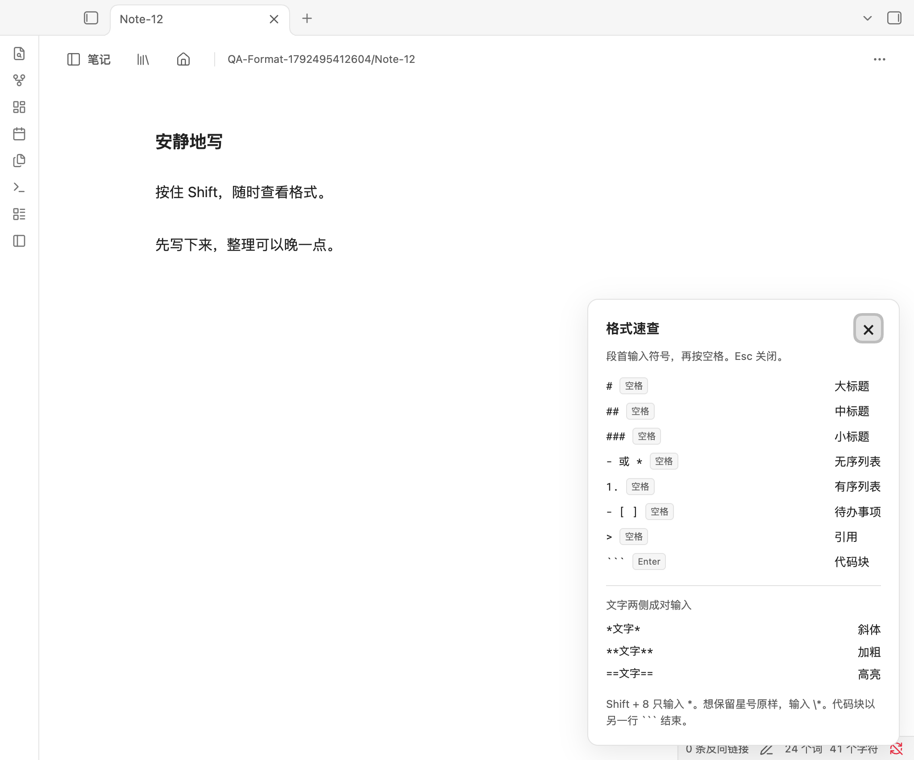
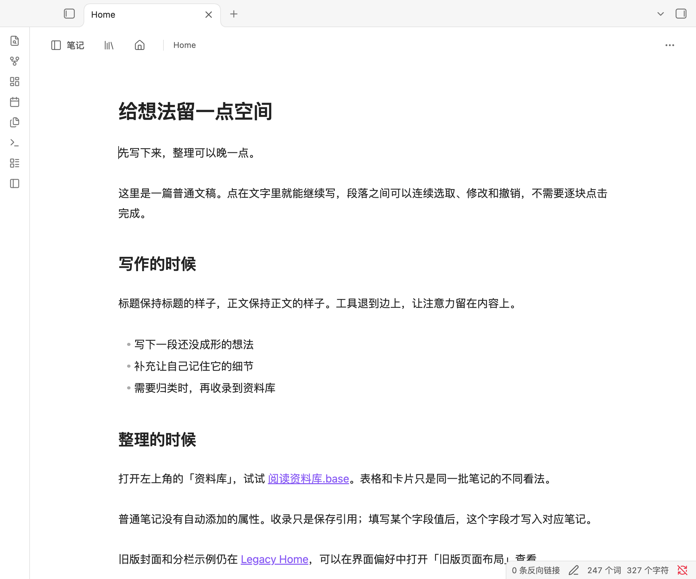
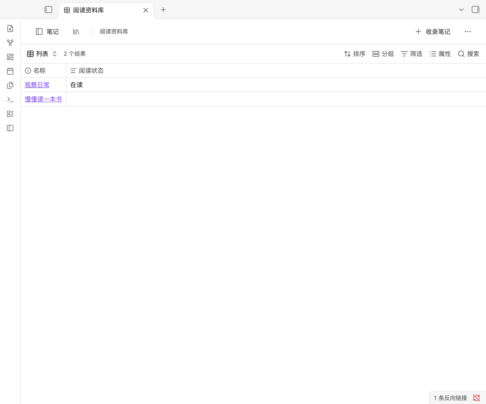

# Nebula Focus 0.9.1

连续写作，按需整理。一个给 Obsidian 做减法的插件。GPL-3.0-only。

**实验性预发布。**已在 Mac 的真实 Obsidian 中测试；iPhone / Android 真机测试仍待完成。

## 这次的变化

**单独按住 Shift 约 0.6 秒，显示格式速查；松开收起。**标题、列表、待办、引用和代码块的段首输入方式集中展示。Shift + 8 和 Shift + 方向键照常使用；「更多 → 格式速查」可持续显示，按 Esc 关闭。命令面板也有 `Nebula Focus: Show formatting guide`，可自行绑定热键。速查只提供提示，不修改正文。

修复普通段落开头只输入一个 `*` 就整段变斜、星号又被隐藏的问题。未配对的星号现在保持可见，补齐 `*文字*` 后才显示斜体。`* `（星号后加空格）仍是列表；`\*` 表示字面星号。复杂 Obsidian 扩展语法与旧版布局继续使用原生行为。



正文改为一整篇连续编辑，使用 Obsidian 的原生实时阅览编辑器。可以跨段落选取、输入、粘贴、撤销重做，不再逐块进入编辑，也不再有“完成 / 取消”框。标题、粗体、斜体等常用格式的标记保持隐藏，光标进入标题时文字不会被 `###` 向右推。

资料库是单独入口。写作页面默认只留下文稿、笔记导航和少量操作；封面、分栏、拖动分区保留在可选的“旧版页面布局”中。



## 资料库与属性

- **普通文稿不自动增加属性。**打开、编辑、收录一篇笔记，都不会替它补上空的状态、日期、类型等字段。
- **收录不移动、不复制笔记。**引用清单在独立 `.base` 文件里，一篇笔记可以出现在多个资料库。
- **添加字段只增加一列。**在资料库中填写某篇笔记的字段值时，Obsidian 才把这个值写进那篇 Markdown 的 YAML 属性。
- **写作页面默认隐藏属性区域。**需要查看时，使用“更多 → 显示笔记属性”；“查看 Markdown 源码”可查看完整原文。
- **移出资料库不会删除内容或属性。**已经填写的字段仍属于笔记本身。
- 表格、卡片、排序、筛选、字段类型等由 Obsidian 原生 Bases 承载。字段名称相同，就表示同一个笔记属性；不同用途的状态请用不同名称，例如“阅读状态”“项目状态”。



## 如何试用

1. 从 [0.9.1 预发布页面](https://github.com/AnthemZhou/Nebula_Focus/releases/tag/0.9.1) 下载安装包，将 `nebula-focus` 文件夹放入测试库的 `.obsidian/plugins/`。
2. 启用插件。桌面端在插件设置中关闭“仅在手机和平板启用”。打开 Markdown 即可连续写作。
3. 在 Obsidian“设置 → 核心插件”启用“数据库 / Bases”。点击左上角“资料库”，新建并选择收录笔记。
4. 资料库右上角“收录笔记”管理成员；“资料库操作 → 添加字段”增加空列，“新建笔记”创建空白文稿并收录。
5. 在表格单元格内填写字段值，点击原生卡片打开笔记。排序、筛选、视图切换使用原生资料库工具栏。
6. 源码包的 `examples/vault/` 和独立 examples ZIP 提供示例。复制到空白测试库，避免覆盖自己的 Home.md。

`docs/mobile-preview.html` 是可离线切换的**真实 Mac Obsidian 截图预览**。它不编辑笔记，不模拟编辑器，也不代表手机真机测试。旧版可交互预览保留在带版本号的历史 HTML 中。

## 数据与兼容

笔记正文仍是普通 Markdown；已填写的属性仍是原生 YAML。资料库成员、列顺序、视图及筛选存在 `.base` 文件中。备份整个笔记库即可一起携带，停用 Nebula Focus 后仍可通过 Obsidian Bases 打开资料库。

0.8 的 `nf-*` 外观属性、附件和卡片标记不会自动删除或迁移。需要旧版页面时，在“界面偏好”启用“旧版页面布局”。旧版恢复草稿也保留，通过旧版页面底部的恢复入口访问。

连续写作使用 Obsidian 自身的保存、撤销和文件恢复机制；旧版逐块编辑的草稿缓存和历史机制只适用于兼容模式。源码回退可随时使用，不会把复杂内容转为普通文字。

资料库在插件启用时跟踪笔记和文件夹的改名。停用期间改名或从外部修改文件路径，可能需要重新收录；缺失的引用不会让资料库扩大成全库查询。手动重写资料库的收录筛选后，插件会拒绝继续修改无法识别的范围，请使用原生筛选管理。添加其他筛选时推荐使用“此视图”区域。

详见 [文件格式](docs/PAGE-FORMAT.md) 和 [验证记录](docs/TESTING.md)。最低 Obsidian 1.9.0；当前实测版本为 1.14.4。没有网络请求、遥测、AI 接入或自建同步服务。

## 开发

```sh
npm ci
npm run build
npm test
node scripts/demo.mjs
npm run package
npm run prepare:test-vault
```

在实际 Obsidian 打开命令打印的隔离测试库并启用插件后，运行：

```sh
node scripts/obsidian-writing-smoke.cjs /absolute/path/to/the/test-vault
node scripts/obsidian-format-smoke.cjs /absolute/path/to/the/test-vault
```

运行时代码使用公开 Obsidian API，不导入 Node / Electron。测试驱动通过本机 Obsidian CLI 连接带标记的临时库，拒绝操作其他库。浏览器预览另有 `scripts/visual-check.cjs`。

## License

Copyright © 2026 Shengyu Zhou. GPL-3.0-only. [Effie](https://blog.effie.co/effie-tutorial-mac/) 是安静写作体验的参考，[shadcn/ui](https://github.com/shadcn-ui/ui) 是间距、边框与配色的参考；未复制它们的实现。界面使用原生 Obsidian API 和插件范围内的 CSS，没有添加 React / Tailwind 运行时。旧版矢量封面为原创。依赖许可证见 [THIRD-PARTY-NOTICES.md](THIRD-PARTY-NOTICES.md)。
