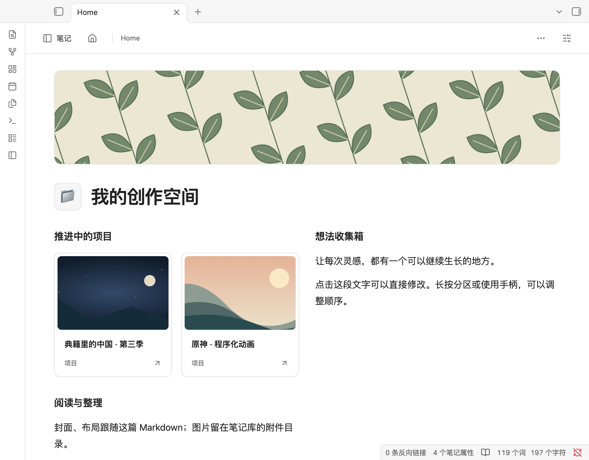

# Nebula Focus 0.6.1

Quiet, portable pages for Obsidian. GPL-3.0-only. **Experimental prerelease: tested in real macOS Obsidian 1.14.4; physical iOS/Android testing is still pending.**

## 这版可以做什么

0.6.1 参考 [shadcn/ui](https://ui.shadcn.com/) 的视觉设计，统一了紧凑导航、封面与标题比例、细边框卡片、输入框和弹窗。颜色跟随 Obsidian 当前主题，手机保留较大的点击区域。



- 选择三张原创矢量封面，或上传 PNG/JPEG/WebP/GIF/AVIF（20 MB 以内）；选用后图片保存在笔记库的 `Nebula Assets/`。
- 封面裁切、页面标题、图标、单/双栏及栏宽比例保存在当前 Markdown 顶部。正文顺序就是显示顺序。
- 点击普通文字即可在页面中修改当前分区，无需先进入统一编辑模式。当前分区使用 Markdown 文本输入，含粗体、引用和列表快捷操作；完成或点击分区外部保存。
- 每个 `## 二级标题` 及其下方内容作为一个分区。使用手柄拖动，或菜单上移/下移。开头没有二级标题的说明保留在顶部。桌面手柄悬停出现；手机可长按分区打开菜单，或操作其左侧手柄。支持手柄上 Alt+上下键。
- 页面外观菜单提供单栏或双栏（35/65、50/50、65/35）。笔记面板宽度 650px 以下自动单栏（包括桌面分栏），按文件顺序阅读；布局值保留。
- 普通项目链接列表可切换为封面卡片；卡片打开原笔记，不复制项目资料。
- 上传正文图片，自动生成图片分区和本地附件引用。点图查看大图。
- 简洁导航、首页入口、恢复原界面保留。默认在手机/平板启用；桌面请在设置关闭“仅在手机和平板启用”。

## 如何试用

1. 安装包解压后，将 `nebula-focus` 文件夹放入笔记库 `.obsidian/plugins/`，确认 `main.js`、`manifest.json`、`styles.css` 直接位于该目录。
2. 启用插件，打开一篇 Markdown 笔记。桌面端需在插件设置中启用桌面支持。
3. 右上角“页面外观”调整封面、图标和分栏；“更多 → 原生 Markdown 编辑器”可使用原编辑器，点击“返回页面”回来。
4. 用 `##` 划分可移动的内容分区；点击内容输入，在分区操作菜单中切换卡片显示。
5. 示例库位于源码包的 `examples/vault/`，也提供独立 examples ZIP。请复制到空白测试库，包含 `Nebula Assets` 与项目文件，不要覆盖自己的 Home.md。

安装文件、完整源码和示例库请从 [0.6.1 预发布页面](https://github.com/AnthemZhou/Nebula_Focus/releases/tag/0.6.1) 下载。尚未进入 Obsidian 社区插件目录。请先在测试库中试用。

`docs/mobile-preview-0.6.1.html` 是可离线打开的模拟宿主演示，使用真实插件代码、简化的 Markdown 渲染器和示例资料。演示修改只存在当前页面内存，刷新后还原；草稿使用浏览器本地缓存。它不是实际 Obsidian，也不访问你的笔记库。

## 数据格式和备份

```yaml
---
nf-title: "我的创作空间"
nf-icon: "📁"
nf-cover: "[[Nebula Assets/cover.svg]]"
nf-cover-y: 50
nf-columns: 2
nf-ratio: 35
---
```

```markdown
## 项目

<!-- nf:view=cards -->

- [[项目/示例项目]]

## 想法

正文仍是普通 Markdown。
```

只在用户修改外观或内容时写入。阅读不会自动转换文件。每次写入使用 Vault.process 检查原文版本；外部变化会拒绝覆盖。输入时缓存一份本机恢复草稿，失败/取消后可通过页面底部“恢复未保存草稿”复制，成功保存后清除。缓存是应急措施，不能替代笔记库备份；敏感内容的未保存草稿也会留在本机应用存储中。

**恢复完整页面需要 Markdown 和引用的附件。**仅复制 Markdown 可以保留布局字段，但不能携带图片。关闭插件后正文、标题、链接和图片引用仍保留；封面和双栏需要插件解释。标题别名不会重命名实际文件。参见 `docs/PAGE-FORMAT.md`。

## 范围和限制

- 本版是按二级标题分区的直接编辑和拖动，不是逐段所见即所得的 Notion 编辑器；输入时会看到该分区的 Markdown 语法。
- 双栏按从左到右、从上到下排列分区，不支持任意嵌套或自由坐标。
- 卡片来自显式 `- [[笔记]]` 列表，不是数据库查询或状态看板；卡片内容取目标标题、封面和所在文件夹。
- MarkdownRenderer 展示不是原生编辑器的完整替代。复杂嵌入、任务交互、第三方渲染、脚注与跨分区引用等必须实机核对，必要时切换原生编辑器。
- “页内查找”会自动切到原生 Markdown 编辑器，再打开查找。
- 不含 Excel/账本、AI 接入、AI 清理导出、同步、页面打包备份功能；没有网络请求或遥测。
- 中文页面功能已实现；0.6 页面新增菜单暂为中文，旧导航支持中英文。
- 已于 2026-10-17 在 Mac 的真实 Obsidian 1.14.4 中验证编辑、草稿、外部冲突、附件、拖动、原生回退及默认深浅主题；中文组合输入通过实际 Chromium IME 通道测试。iPhone/Android 的键盘、触摸、长按和第三方主题仍需实机验证。

## Development

```
npm ci
npm run build
npm test
node scripts/demo.mjs
npm run package
```

For a fresh isolated vault with desktop mode enabled, run `npm run prepare:test-vault`. Open the printed folder in Obsidian and enable the plugin, then run `node scripts/obsidian-smoke.cjs /absolute/path/to/the/test-vault`. This uses the actual Obsidian CLI and refuses vaults without the test marker. Reports and screenshots go to `test-results/`. See [validation details](docs/TESTING.md). The separate HTML preview check additionally needs Playwright and Chromium.

Main runtime uses public Obsidian APIs, no Node/Electron imports. Minimum Obsidian 1.8.7.

## License

Copyright © 2026 Shengyu Zhou. GPL-3.0-only. The three vector covers in `src/covers.ts` are original code-generated illustrations under the same license. Hider, Minimal and [shadcn/ui](https://github.com/shadcn-ui/ui) were design references; no component implementation was copied. The UI uses original scoped CSS and native Obsidian APIs; no React or Tailwind runtime is added. Runtime dependency: Obsidian API supplied by the host.
